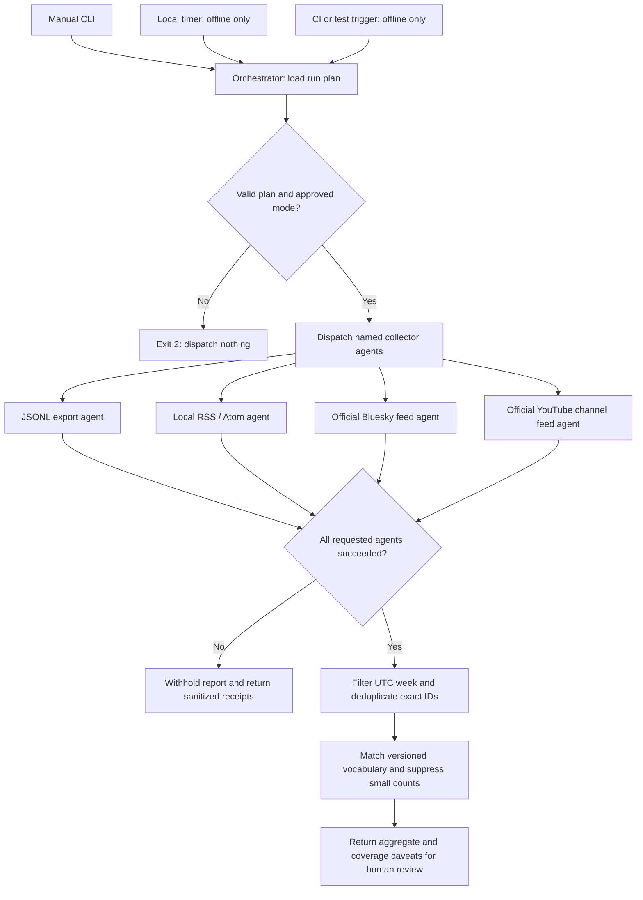

# Agent workflow

The orchestrator calls modules, not prompts. A coding agent can operate the workflow using the [skill](../skills/social-media-intake/SKILL.md), but no LLM, credential store, or external automation service is required to dispatch collectors.

Only agents selected by the plan run. Offline and live sources cannot be mixed in one run. Dispatch is sequential and bounded to five sources. No output is sent to any third party.

## Callable agents

| Agent | What it receives | What it reads | What it returns to the orchestrator |
| --- | --- | --- | --- |
| JSONL export | Local path | Fixture or approved normalized export; offline | Identifier, timezone-aware publication timestamp, text |
| RSS/Atom file | Local path | Fixture or approved XML snapshot; offline; title only | Identifier, publication timestamp, title |
| Bluesky publisher | Approved organizational handle | One official author-feed page; excludes replies, reposts and off-publisher posts | Post identifier, timestamp, text |
| YouTube channel feed | Approved organizational channel ID | One official Atom feed request; validates channel; no playback, comments or transcript | Video identifier, publication timestamp, title |

All rows stay in process memory for the run. The release candidate omits raw rows, source identifiers and per-source counts in live mode. The human reviewer compares the aggregate with the approved vocabulary, checks limitations and decides whether to release or revise; the agent does not publish.

## Handoff and failure

An invalid plan yields exit 2 and calls no agents. A failed source yields exit 1, sanitized status receipts, and no aggregate. There is no fallback to alternative hosts or browser scraping. An aggregate candidate yields exit 0 and status `review-required`; that status is not a claim of approval or completeness. Do not use a report for disease case counts or treatment decisions.

See [specification](../docs/workflow-specification.md) and [trigger entry points](../triggers/README.md).
