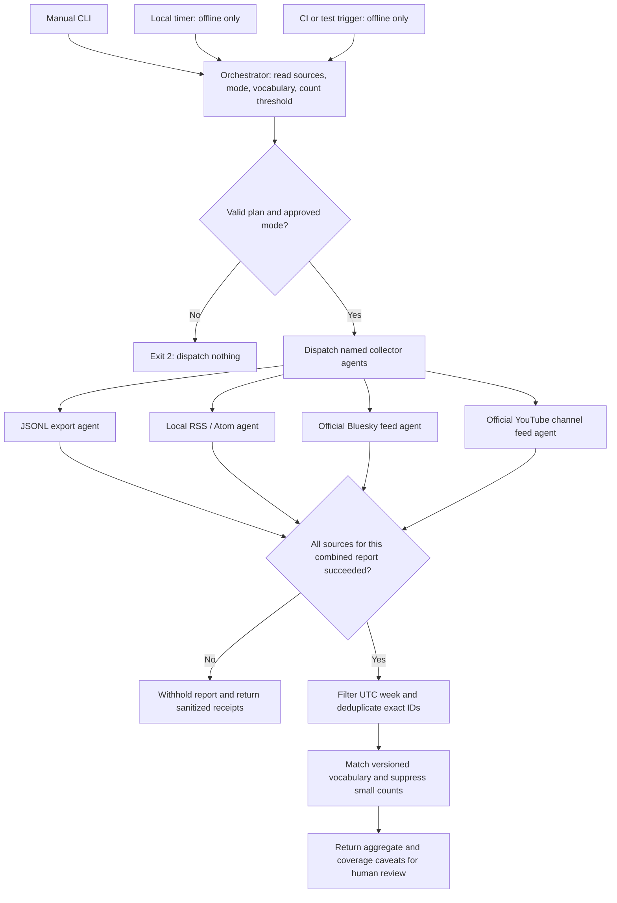

# Agent workflow

The orchestrator calls modules, not prompts. A coding agent can operate the workflow using the [skill](../skills/social-media-intake/SKILL.md), but no LLM, credential store, or external automation service is required to dispatch collectors.



Only agents selected by the plan run. Offline and live sources cannot be mixed in one run. Dispatch is sequential and bounded to five sources. No output is sent to any third party.

## What needs to wait?

**Only a combined report needs to wait for every source named in its plan.** A one-source plan runs only that collector. A failed multi-source run still returns source status, but no combined counts: a source that fails is missing, not zero. The current CLI returns those status receipts together at the end. See [three runnable examples](../examples/reporting.md) for a source-only report, a deduplicated combined report and a failed-source receipt.

## Callable agents

| Agent | What it receives | What it reads | What it returns to the orchestrator |
| --- | --- | --- | --- |
| JSONL export | Local path | Fixture or approved normalized export; offline | Identifier, timezone-aware publication timestamp, text |
| RSS/Atom file | Local path | Fixture or approved XML snapshot; offline; title only | Identifier, publication timestamp, title |
| Bluesky publisher | Approved organizational handle | One official author-feed page; excludes replies, reposts and off-publisher posts | Post identifier, timestamp, text |
| YouTube channel feed | Approved organizational channel ID | One official Atom feed request; validates channel; no playback, comments or transcript | Video identifier, publication timestamp, title |

All rows stay in process memory for the run. The release candidate omits raw rows, source identifiers and per-source counts in live mode. The human reviewer compares the aggregate with the approved vocabulary, checks limitations and decides whether to release or revise; the agent does not publish.

## Handoff and failure

An invalid plan yields exit 2 and calls no agents. A failed source yields exit 1, sanitized status receipts, and no aggregate. There is no fallback to alternative hosts or browser scraping. An aggregate candidate yields exit 0 and status `review-required`; that status is not a claim of approval or completeness. Do not use a report for disease case counts or treatment decisions.

See [specification](../docs/workflow-specification.md) and [trigger entry points](../triggers/README.md).

## Exactly what “load run plan” does

The **run plan is a JSON configuration file** passed with `--plan`. It tells the orchestrator **which collector to call for each source and what to give it**. The orchestrator is the Python program that reads this file and makes the calls. **The plan does not contain credentials.** All four implemented collectors use either a local file or a public feed endpoint that the code calls without an API key, OAuth token, cookie, or login. Approval to use a source is separate from authentication.

### The four plan fields

| Field | What you supply | How the orchestrator uses it |
| --- | --- | --- |
| `mode` | `offline` or `live` | `offline` permits local files only; `live` permits only the two public-feed adapters below. A plan cannot mix modes. |
| `sources` | An array of one to five objects, each with `name`, `kind`, and `target` | `name` is a unique lowercase label such as `publisher-feed`; `kind` selects the collector; `target` identifies the exact file, publisher handle or channel ID. Unknown fields and duplicate targets within a collector kind are rejected. |
| `vocabulary` | Path to a separate JSON file, relative to the plan file | Maps report categories to the literal terms to match, for example `{"themes":{"support-resources":["community support","support resources"]}}`. This is not a list of search queries sent to platforms. Terms are matched after collection. |
| `min_count` | Integer, at least 1 offline or 5 live | Omits themes below this minimum distinct-item count from the aggregate. The demo uses 1 because all of its inputs are fictional. |

The reporting week is a **CLI argument**, not a fifth JSON field: `--week 2026-11-23` means Monday Nov. 23 through Sunday Nov. 29 in UTC. A live run must use a completed week and the manual trigger. The explicit `--confirm-approved-sources` flag is the operator's confirmation, not a platform credential.

### What to put in each source entry

| `kind` | Exact `target` format | What it opens | Credentials needed by this version |
| --- | --- | --- | --- |
| `jsonl` | Local path such as `fictional-posts.jsonl`, relative to the plan | Reads JSONL with `id`, `created_at`, and `text`. Timestamp needs a timezone offset. | None. The process needs local read access. |
| `rss-file` | Local path such as `fictional-feed.xml`, relative to the plan, **not a URL** | Reads a saved RSS or Atom file. RSS needs item `guid`, `pubDate`, `title`; Atom needs entry `id`, `published`, `title`. | None. The process needs local read access. |
| `bluesky` | Publisher handle such as `publisher.example`, with no leading `@` or URL | Calls `https://public.api.bsky.app/xrpc/app.bsky.feed.getAuthorFeed` with that handle as `actor`, requesting one page of up to 50 posts. | None. The code uses the public endpoint; a denied request fails the source. |
| `youtube` | Channel ID beginning with `UC` and followed by 22 letters, digits, underscores, or hyphens; **not** an `@handle` or channel URL | Calls `https://www.youtube.com/xml/feeds/videos.xml` with that ID as `channel_id`. Reads only titles and the fields needed for validation and deduplication. | None. This is the public channel feed, not a signed-in YouTube API client. |

Reddit, X, and Facebook are **not valid collector kinds yet**. Their workflows are references, and this program has no credential fields or secret bindings for them. A future authenticated collector would need its own implementation: the plan could name a secret reference, but the actual token would stay in the operator's environment or secret store, never in the plan or GitHub.

### Complete runnable example

Save this as `examples/orchestrator-demo.json` alongside the referenced example files. It is [already checked in](../examples/orchestrator-demo.json).

```json
{
  "mode": "offline",
  "vocabulary": "fictional-themes.json",
  "min_count": 1,
  "sources": [
    {"name": "example-social-export", "kind": "jsonl", "target": "fictional-posts.jsonl"},
    {"name": "example-publisher-feed", "kind": "rss-file", "target": "fictional-feed.xml"}
  ]
}
```

```sh
python3 -m social_media_agent.orchestrator \
  --plan examples/orchestrator-demo.json --week 2026-11-23
```

The orchestrator calls `jsonl` with `examples/fictional-posts.jsonl` and `rss-file` with `examples/fictional-feed.xml`. Both responses pass validation; after deduplication, the report contains four distinct items. Remove the second object and only the JSONL collector runs. For a live plan, change the mode to `live`, use a threshold of at least 5, replace the offline entries with approved publisher handles or channel IDs, and keep that plan in a local file such as `sources.local.json`. Do not pass the confirmation flag until those sources and their intended use have been approved. Live collection is not deployed.
